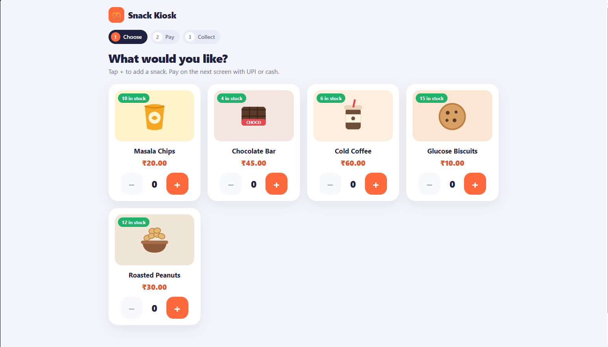
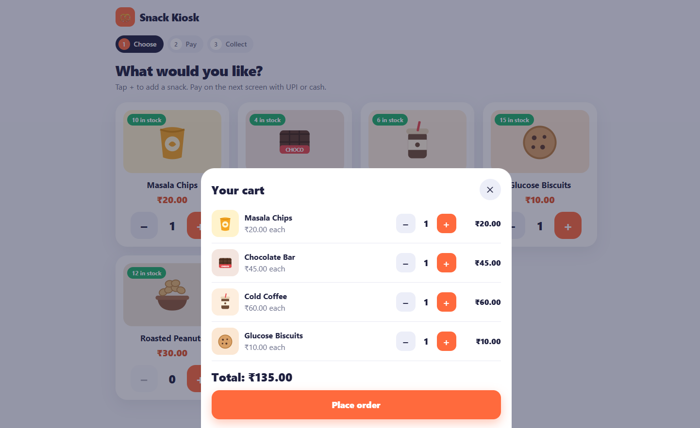
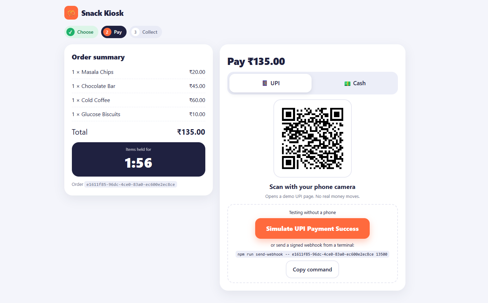
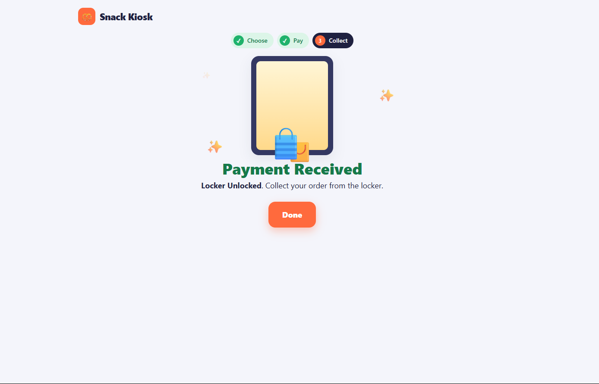

# Pickup Counter

Snack counter: pick items, pay by UPI (simulated), collect from a locker. Express, PostgreSQL, React (Vite), TypeScript.

| Choose products | Cart |
|---|---|
|  |  |
| **Pay (2-minute hold countdown)** | **Paid: locker unlocked** |
|  |  |

## Setup

Requires Docker, and Node.js 20+ for the webhook script and tests.

```bash
git clone https://github.com/man-su-97/smart-kiosk.git
cd smart-kiosk
docker compose up --build
```

Open http://localhost:5173 (API on http://localhost:3000).

**Pay an order** (order id and amount are shown on the payment screen):

```bash
cd backend && npm install
npm run send-webhook -- <orderId> <amountPaise>
```

**Pick up:** `curl -X POST localhost:3000/orders/<orderId>/pickup-claim`

## Tests

Run against a real PostgreSQL database:

```bash
docker compose up -d db
cd backend && npm install && npm test
```

Browser tests (app must be running): `cd e2e && npm install && npx playwright install chromium && npm test`

## Decisions

- Stock is held by unpaid orders for 120 s and only reduced at pickup. Orders lock the product rows, so stock is never oversold.
- A webhook event id is stored once, so repeats change nothing. Wrong amount → `needs_review`.
- Pickup succeeds only if the order is still `paid`, so a second claim gets 409.
- The countdown uses seconds left from the server, not the kiosk clock.
- **Late payment:** if the units are still free the order is paid; if someone else took them it goes to `needs_review` for a refund.

## Assumptions

- Paid orders not yet picked up also hold their units.
- Single API instance, no authentication for the kiosk or locker.

## Next

Refund screen for `needs_review` orders, rate limiting on orders, locker authentication, production frontend build.

AI usage: see `AI_NOTES.md`.
